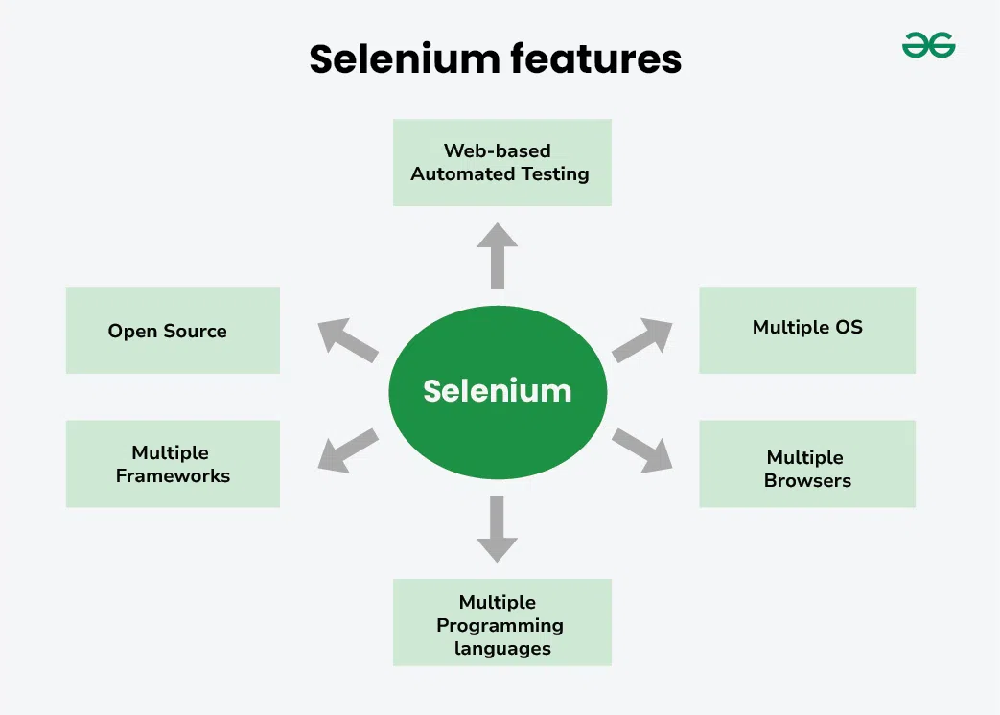

# Day-1 - Selenium Fundamentals

## Goal

Understand what **Selenium** is, how browser automation works, and get your first Selenium + Java program running.

### What you will Learn:

- What Selenium is
- What Selenium WebDriver is
- Why browser automation exists
- Manual vs automation testing
- Selenium's basic architecture
- Browser <-> WebDriver communication
- The W3C WebDriver concept.
- Selenium 4 and Selenium Manager
- Selenium vs Playwright vs Cypress
- What Selenium can and cannot automate
- Creating your first Maven + Selenium project

### What is Selenium

**Selenium** is open-source automation testing framework used to automate web applications across different browsers and operating systems.



Imagine you have a website:

```text
https://example.com
```

A human tester can:

1. Open browser
2. Type the URL
3. Click a button
4. Enter some text
5. Check the result
6. Close the browser

Now imagine human tester need to perform these **same 6 steps 500 time** after every software release.

Doing it manually would be:

- Slow
- Repetitive
- boring
- prone to human mistakes
- Consume lots of time

And this is where **browser automation** comes in.

#### Simple definition

Selenium is a collection of tools that allow us to automate web browsers.

Instead of you manually controlling Chrome:

```text
 You
  |
 Chrome
  |
 Website
```

Your program will controls the Browser:

```text
 Java
   |
 Selenium WebDriver
   |
 Chrome
   |
 Website
```

So the selenium is not a tool that click buttons.
The bigger idea is:
**Selenium allow program to control and interact with web applications.**

#### Why selenium exists

Suppose you are working on a e-commerce company.
Every time the developer releases a new version, you need verify:

```text
 Login works
  |
 Search works
  |
 Product opens
  |
 Add to cart works
  |
 Checkout works
```

A manual tester has to perform these step repeatedly.
But with **Selenium**, We can turn that work flow into code.
e.g.,

```java
driver.get("https:example.com");

driver.findElement(...).sendKeys("laptop");

driver.findElement(...).click();

assertSomething();
```

This is how you perform the repeatitive work with the help Selenium.

But there's is an important distiction:
**Selenium doesn't decide whether your application is correct.**
You write the test logic.
e.g.,

```text
Open login page
  ↓
Enter Username
  ↓
Enter Password
  ↓
Click login
  ↓
Is dashboard displayed?
  ↓
YES → Test passes
No → Test Failed
```

Selenium give you the ability to interact with browsers.
Your test code decides **what should happen** and **what count as success**.

#### Selenium vs Selenium WebDriver

Selenium WebDriver is an API that allow our java program to control the browser.

Conceptually:

```text
Your Java Code
  ↓
WebDriver API
  ↓
Browser API / Selenium Manager
  ↓
Chrome
```

e.g.,

```java
webDrive driver = new ChromeDrive();

driver.get("https://example.com");
```

The important thing here isn't memorizing those line yet.
Think about what they mean:

```java
webDriver driver
```

means:

```text
I have an object through which my program can control a browser.
```

```java
new ChromeDriver();
```

means:

```text
Create a webdriver implementation that controls the Chrome.
```

#### First reasoning question

Think about it?

```java
WebDriver driver = new ChromeDriver();
```

Why do you think we write:

```java
WebDriver driver
```

instead of:

```java
ChromeDriver driver
```

Ans:
conceptually:

```text
WebDriver ← interface
  ↑
ChromeDriver ← Class
```

`ChromeDriver` implements the `WebDriver` interface.

### How to initialize java and selenium project with Maven

First Check the Installations:

```text
java -version
```

```text
mvn -version
```

```text
Open InteliJ
  ↓
Files
  ↓
New Project
  ↓
Then Set:

  Name: as you prefered
  Build system: java / maven
  JDK: 21 atleast
  GroupId: com.(as you prefered)
  ArtifactId: (this will goas as the project name)
```

When you create a maven project you will get and **pom.xml** file like this:

```xml
<?xml version="1.0" encoding="UTF-8"?>
<project xmlns="http://maven.apache.org/POM/4.0.0"
         xmlns:xsi="http://www.w3.org/2001/XMLSchema-instance"
         xsi:schemaLocation="http://maven.apache.org/POM/4.0.0 http://maven.apache.org/xsd/maven-4.0.0.xsd">
    <modelVersion>4.0.0</modelVersion>

    <groupId>com.sendo</groupId>
    <artifactId>selenium_project_setup</artifactId>
    <version>1.0-SNAPSHOT</version>

    <properties>
        <maven.compiler.source>21</maven.compiler.source>
        <maven.compiler.target>21</maven.compiler.target>
        <project.build.sourceEncoding>UTF-8</project.build.sourceEncoding>
    </properties>

</project>
```

Important pieces are:

````xml
<groupId>com.sendo</groupId>
<artifactId>selenium_project_setup</artifactId>
<version>1.0-SNAPSHOT</version> ```
````

This is also known as identity of you project:

- `groupId` → identifies the organization/package group
- `artifactId` → identifies the project
- `version` → identifies the project's version

Then:

```xml
<properties>
  <maven.compiler.source>21</maven.compiler.source>
  <maven.compiler.target>21</maven.compiler.target>
</properties>
```

You're telling Maven:
Compile this project using Java 21

**To add dependencies here we get <dependencies> tag that inclose the dependencies**
